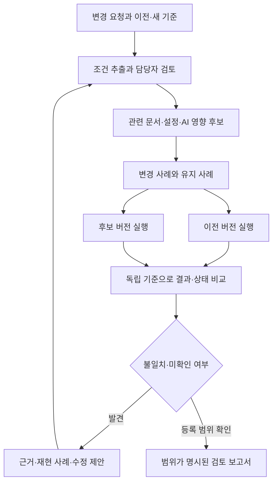

# 업무 변경 리허설 AX

삼성·LG·KB 등 업종이 다른 대기업에 제시할 공통 문제와 구현 계획

설계 문서 3.2 · 구현 상태는 HANDOFF.md 참조

**한 문장:** 규정·제품 조건·업무 설정이 바뀌었을 때, 관련 문서·업무 프로그램·AI 답변이 함께 바뀌었는지 시험하고, 바뀌면 안 되는 기존 동작까지 검증하는 시스템.

**현재 산출물 상태:** Python 표준 라이브러리 기반 합성 실행 코어, 엄격한 계약 검사, 자동 회귀 테스트와 고객서비스 FAQ/API 재검증 HTML 보고서를 구현했다. LLM·문서 자동 분석·실제 기업 연동·현업 평가는 미구현이다. 자세한 범위와 재현 명령은 HANDOFF.md를 참조한다.

## 1. 이번 요구에 맞춘 프로젝트 방향

이 프로젝트는 업종별 규정의 차이를 보존하면서 공통 실행 검증 구조를 사용하는 것을 목표로 한다. 이를 위해 적용 업종을 무작정 늘리는 대신, **변경사항을 여러 산출물에 일관되게 반영하고 검증하는 문제**를 제품의 중심으로 고정한다.

제품에서 처리하는 기본 단위는 ‘회사 전체’가 아닌 **하나의 변경 요청**이다. 예를 들어 점검 주기 변경, 수수료 면제 조건 변경, 반품 기간 변경을 각각 하나의 작업으로 등록한다. 담당자는 영향받는 자료와 시스템, 시험에서 발견된 불일치, 아직 확인하지 못한 대상을 본다.

이전 계획의 문서 정합성 검증은 원문·조건·버전 분석 모듈로 발전시킨다. 기존 Agent Regression Lab의 접근은 실행 결과와 상태 변화 검증에 연결한다. 기존 설계 자산을 재사용하되 구현된 코드가 있다고 가정하지 않는다.

모든 대기업의 관심이나 채용을 보장할 수는 없다. 목표는 **업종에 관계없이 문제를 설명할 수 있고, 지원 조직에 맞는 검증 사례를 선택해 보여주는 것**이다. 모델 연구·반도체 소자 연구·저수준 제어 등 모든 전문 직무에 동일하게 최적화된 기획은 아니다.

## 2. 기업 수요: 직접 확인한 내용과 우리의 추론

| 조직 | 공식 근거 | 강도와 한계 | 프로젝트에 연결되는 부분 |
|---|---|---|---|
| 삼성SDS | 2026-08-19 PLM 자료에서 변경 영향 분석·설계 검토·BOM 정합성 점검을 AI 활용 방향으로 설명 | 공식 기술 방향. 해당 기능의 고객별 구매·운영 실적과 구분 | 변경이 연결된 산출물에 미치는 영향 |
| 삼성금융 | 2026 협업 과제로 약관·증권 검증, 규칙 구조화, 에이전트 평가·관측 인프라 제시 | 구체적인 협업 수요. 당시 모집은 종료 | 문서 근거와 AI 판단·행동의 검증 |
| LG화학 | 2026-11-05 발표에서 공정안전관리의 여러 서류를 대조하는 AI 적용 소개 | 회사가 발표한 적용 사례 | 문서 간 정합성과 절차 반영 확인 |
| LG CNS | 운영 로그·코드 영향 분석, 유지보수, 시험과 배포 전후 검증을 지원하는 서비스 공개 | 기업 제공 기능. 우리의 상업적 경쟁자이기도 함 | 변경 전후 실행 검증 |
| KB국민은행 | 2026-06-25 금융상담 AI 답변 평가·통제 관련 티냅스 협업 발표 | 공동 실증·협업 근거. 전체 업무 상용화를 의미하지 않음 | 규정과 AI 답변의 일치 여부 |

근거는 [S01]~[S05]다. 여기서 ‘업무 변경 전후를 함께 검증하는 시스템에 연결할 수 있다’는 것은 우리의 제품 설계상 추론이다. 위 기업들이 이 프로젝트를 요청했다거나 구매할 것이라는 뜻이 아니다. 특히 삼성SDS의 자료를 삼성전자 모든 사업부의 확정 요구로 바꾸어 말하지 않는다.

회사의 발표 수치를 우리 목표 성능으로 옮기지 않는다. 공개 자료로 확인되지 않은 절감액·오류 빈도·사용자 불만 수는 만들지 않는다.

## 3. 왜 업종을 넘어 설명할 수 있는가

변경의 내용은 다르지만, 작업에는 반복되는 구조가 있다.

| 공통 구조 | 제조 예시 | 금융 예시 | 고객서비스 예시 |
|---|---|---|---|
| 변경된 기준 | 점검 주기 | 면제 조건 | 반품 가능 기간 |
| 관련 설명 | 작업표준서·점검표 | 상품 설명·FAQ | 정책 문서·상담 매뉴얼 |
| 실행하는 시스템 | 점검 일정 프로그램 | 모의 수수료 판정 API | 모의 반품 판정 API |
| 안내하는 AI | 작업 지원 AI | 상담 AI | 고객센터 AI |
| 변경 실패 | 옛 주기로 계속 예약 | 새 조건을 만족해도 유료 안내 | 새 정책 대상인데 반품 거절 |
| 유지할 예외 | 다른 장비군 기준 | 기존 상품·다른 고객 유형 | 개봉 상품 등 제외 조건 |

첫 버전의 범용성은 세 업종의 모든 업무를 해결한다는 뜻이 아니다. **같은 변경·검증 엔진으로 세 가지 제한된 규칙 변경을 처리한다**는 뜻이다. 업종 이름만 바꾼 화면 세 개로 범용성을 주장하지 않는다.

## 4. 사람의 문제와 구매 판단을 분리한다

| 역할 | 확인할 문제 가설 | 필요한 결과 | 검증할 지표 |
|---|---|---|---|
| 현업 담당자 | 규정 변경 시 무엇을 같이 고쳐야 하는지 누락 | 영향 후보·담당자·원문 | 반영 누락과 재작업 시간 |
| 개발자 | 요청 문서와 실제 프로그램 조건이 다름 | 재현 가능한 입력·기대값·실제값 | 재현·수정 확인 시간 |
| QA·SQA | 변경 후 기존 기능까지 매번 다시 확인 | 바뀔 동작과 유지할 동작의 시험 | 중요한 누락·불필요한 시험 |
| 상담·운영 직원 | 문서와 시스템 안내가 달라 재문의 | 현재 적용 기준과 근거 | 정정·재문의 사례 |
| AX 책임자 | AI가 맞는 말을 하는지 운영 전 판단 곤란 | 버전별 실행 근거·미확인 범위 | 검토시간·완료율·비용 |

인터뷰는 아직 수행하지 않았다. 구매자는 AX/IT 품질 책임자 또는 업무 운영 조직일 수 있지만, 실제 예산 소유자는 파일럿에서 확인한다. 소비자의 유료 구독 수요를 가정하지 않는다. 소비자의 이익은 잘못된 안내·재처리를 줄이는 데 있다.

## 5. 제품의 핵심 흐름

완료 화면은 ‘회사 전체 정상’이 아니라 ‘이번에 등록한 대상 중 무엇을 시험했고 무엇을 확인하지 못했는지’를 표시한다. 사람의 배포 승인과 제품의 시험 결과는 다른 객체다.

## 6. 시연할 세 가지 변화

아래 규정·기업·사용자는 전부 독자 작성한 합성 예시다. 실제 금융사의 수수료나 제조사의 안전 기준으로 사용하지 않는다. 공통 시행일은 시험을 위해 2026-12-01로 정했다.

### A. 제조: 점검 주기 100시간 → 80시간

- 대상: 가상 장비군 A, 일반 운전, 한국 사업장.
- 시행일 이후 점검 판정에서 누적 운전 80시간 이상이면 점검 작업 요청을 생성해야 한다.
- 특수 운전은 기존 60시간, 장비군 B는 기존 120시간 기준을 유지한다.
- 고장 장면: 작업표준서는 80시간으로 바뀌었지만 일정 프로그램과 작업 지원 AI는 100시간을 사용한다.
- 시험: 79/80/81시간, 시행일 전후, 다른 장비군, 특수 운전, 결측 입력.
- 관찰: 장비를 작동시키지 않고, 모의 점검 작업이 정확히 한 건 생성되는지 확인한다.

### B. 금융: 면제 실적 50만 원 → 30만 원

- 대상: 가상 개인 상품 P1의 월 판정. 적용일은 판정 기준일이며 실제 결제일과 혼동하지 않는다.
- 시행일 이후 월 인정 실적 30만 원 이상이면 모의 결과가 면제다.
- VIP는 기존과 같이 면제, 사업자·다른 상품은 이 예시의 지원 범위 밖이다.
- 고장 장면: 안내문은 수정했지만 상담 AI 또는 모의 판정 API가 50만 원 기준을 유지한다.
- 시험: 299,999/300,000/300,001원, 500,000원, VIP, 시행일 직전, 실적 미확인.
- 관찰: 실제 계좌와 거래를 사용하지 않으며, 입력 원장에 쓰기가 발생하면 실패다.

### C. 고객서비스: 반품 기간 14일 → 30일

- 대상: 시행일 이후 배송 완료된 한국 내 미개봉 일반 상품.
- 기간은 합성 입력의 `elapsed_days`로 주어지고, 마지막 허용 일자를 포함한다. 실제 구현에서 배송일로 계산할 때는 별도 시간 규칙이 필요하다.
- 기존 배송 건은 14일, 주문제작 상품·개봉 상품은 이 예시에서 반품 불가로 유지한다.
- 고장 장면: 정책은 바뀌었지만 FAQ가 14일을 안내하고 접수 API도 반품을 거절한다.
- 시험: 14/15/29/30/31일, 기존 배송 건, 주문제작, 개봉, 배송일 미확인.
- 관찰: 승인 가능한 사례에만 모의 접수 한 건을 만들고, 중복 요청에도 추가 생성하지 않는다.

주 시연은 C를 먼저 완성한다. 사람이 결과를 이해하기 쉽고, 실제 상태 변화도 보여줄 수 있기 때문이다. 이후 A와 B를 같은 인터페이스로 연결한다. 제조·금융의 도메인 전문성까지 검증됐다고 말하지 않는다.

## 7. 면접에서 흥미를 만들 장면

‘AI가 긴 문서를 요약합니다’보다 구체적인 실패와 해결을 보여준다.

1. 반품 정책을 14일에서 30일로 바꾼다.
2. 관련 FAQ·모의 API·상담 AI의 영향 후보가 표시된다. 자동 추론 관계와 사람이 확인한 관계를 구분한다.
3. 20일 지난 미개봉 상품을 시험한다. 새 정책상 승인돼야 하지만 API와 상담 AI가 거절하는 상황을 재현한다.
4. AI 답변만 고치면 API 상태는 여전히 잘못돼 있다는 것을 보여준다.
5. API까지 수정하면 해당 사례는 통과한다. 이어 기존 배송 건과 주문제작 상품은 여전히 예전 규칙이 유지되는지 확인한다.
6. ‘무엇을 바꾸었고, 무엇은 그대로 유지됐고, 무엇은 아직 미확인인지’가 한 화면에 남는다.
7. 같은 엔진에서 제조·금융 합성 팩으로 전환한다. 엔진 코드에 업종별 분기문을 추가하지 않았는지 저장소로 확인한다.

지금은 시연 설계다. 이 장면을 실제로 작동시키는 것이 개발의 완료 조건이며, 미리 정해 둔 성공 애니메이션을 구현하지 않는다.

## 8. 핵심 기능의 우선순위

| 단계 | 기능 | 구체적인 완료 조건 |
|---|---|---|
| P0 | 변경 요청·자산 등록 | 이전/후보 버전과 파일 hash를 고정 |
| P0 | 구조와 근거 보존 | 문단·표·각주에서 추출한 값이 원문으로 연결 |
| P0 | 조건 검토 | 대상·기간·단위·예외를 사람이 확인 가능 |
| P0 | 모의 프로그램 연결 | 동봉 계약으로 실행·상태 관찰·초기화 |
| P0 | 전후 검증 | 바뀔 동작과 유지할 동작을 구분 |
| P0 | 보고서 | 실패·보류·미시험·입력 오류를 분리 |
| P1 | 영향 후보 추출 | 명시적 참조 + 검색을 쓰고 관계 근거 표시 |
| P1 | RAG 답변 연결 | 같은 질문을 이전/후보 자료로 실행 |
| P1 | 시험 후보 생성 | 경계·예외·날짜·정상 대조 사례 생성 후 검토 |
| P1 | 수정안과 재검증 | 변경된 hash에 맞춰 승인과 결과 무효화 |
| P2 | 실제 업무 연결 | 허락받은 테스트 환경의 어댑터 한 개 |

자율 운영·회사 전체 코드 분석·모든 언어 해석·전사 ERP 대체는 이번 버전에 포함하지 않는다. 깊이는 실패 재현과 검증 로직에 투자한다.

## 9. 기술적으로 어려운 부분을 제품 가치에 연결한다

### 9.1 의미 변경 추출

문장 차이와 업무 조건 차이를 구분한다. 표현만 바뀐 경우는 변경 후보를 낮은 우선순위로 두고, 수치·단위·시행일·예외가 달라지면 별도 항목으로 만든다. LLM이 추출한 조건은 검토 전 후보이며, 모르는 조건을 삭제해 단순화하지 않는다.

### 9.2 영향 관계

관계는 `explains`, `implements`, `uses`, `verified_by`처럼 종류를 갖는다. 관계마다 근거 위치·발견 방법·검토 상태·적용 버전을 기록한다. 같은 단어가 등장한다는 이유로 실행상 의존성이라고 확정하지 않는다.

첫 구현은 PostgreSQL 관계 테이블로 충분하다. 그래프 DB 도입 여부는 탐색 성능과 유지보수 실험으로 결정한다. 지원 범위 밖의 코드·자료는 미확인으로 남긴다.

### 9.3 시험의 독립성

규칙을 추출한 모델이 자기 해석으로 기대값을 만든 뒤 스스로 맞았다고 채점하는 구조를 피한다. 결정적인 판정은 사람이 확인한 기준 또는 독립 작성한 합성 정답과 비교한다. LLM 판정이 필요한 문서 의미 비교는 후보와 불확실성을 함께 표시한다.

### 9.4 의도한 변화와 회귀의 구분

전후 결과가 다르다는 이유로 실패가 아니다. 변경으로 달라져야 할 항목은 후보 결과가 새 기대값과 일치해야 하고, 유지할 항목은 불변 조건을 만족해야 한다. 이전 버전부터 있던 오류도 새 변경이 만든 오류와 분리한다.

### 9.5 실제 상태 관찰

모델의 ‘처리했습니다’라는 답변, HTTP 200, 도구 호출 성공을 업무 성공으로 대체하지 않는다. 점검 작업·접수 기록이 기대대로 생성됐는지 별도 조회한다. 처리 결과가 불명확하면 중복 실행 대신 실행 식별자로 상태를 확인한다.

### 9.6 버전 일관성

실행에는 문서·기준·모델·프롬프트·검색 인덱스·어댑터·데이터의 버전을 묶은 manifest를 사용한다. 실행 도중 최신 파일로 교체하지 않는다. 승인 후 내용이 바뀌면 기존 승인은 만료된다.

## 10. 화면 설계

| 화면 | 사용자가 판단할 것 | 표시할 근거 |
|---|---|---|
| 변경 작업함 | 어떤 변경을 검토할 것인가 | 담당자·시행일·등록 대상·진행 상태 |
| 원문과 조건 | 정말 이 조건이 바뀌었는가 | 전후 원문·표·각주·추출 조건·확인 상태 |
| 영향 지도 | 어디를 같이 확인해야 하는가 | 관계 종류·근거·미확인 영역 |
| 리허설 작업대 | 같은 사례의 결과가 맞는가 | 입력·기대값·관찰값·상태 변화 |
| 실패 재현 | 어떻게 같은 오류를 볼 수 있는가 | 고정 버전·seed·실행 명령·실패 지점 |
| 검토 보고서 | 등록 범위에서 배포 판단 자료가 충분한가 | 통과/실패/보류/미시험 수·판정 기록 |

대시보드의 숫자는 저장된 실행 기록에서 계산한다. 임의 성공률과 그래프를 하드코딩하지 않는다. 사용자 인터페이스에서 내부 모델 이름을 과도하게 노출하기보다 근거·불확실성·재현 가능성을 앞에 둔다.

## 11. 아키텍처와 구현 원칙

- 화면: TypeScript 기반 웹 작업대. 원문 비교, 관계 보기, 실행 타임라인, 결과 필터.
- 서비스: Python API와 작업자. HTTP 프레임워크는 착수 시 공식 문서와 팀 환경으로 고정한다.
- 저장: PostgreSQL의 업무 객체·실행 이력, 파일 저장소의 불변 원문·스냅샷·보고서.
- 실행: 격리된 모의 업무 어댑터와 AI 어댑터. 첫 버전은 로컬 함수/프로세스 호출, 실제 외부 쓰기 없음.
- AI: 파서·LLM·임베딩을 교체 가능한 인터페이스로 두고 버전·사용량·실패를 기록한다.
- 관계 분석: 명시 참조와 검색 기반 후보를 결합하고, 검토된 관계와 추론 관계를 구분한다.
- 장시간 작업: 데이터베이스 작업 상태와 재시작 시 재개 규칙을 먼저 설계한다. 처음부터 대규모 분산 플랫폼을 요구하지 않는다.

C++/C# 경험은 상태 무결성·수명·재시도·기존 시스템 어댑터에서 활용할 수 있다. 첫 공통 엔진에 여러 언어를 추가해 복잡도를 늘리지는 않는다. 실제 C# 모의 서비스 어댑터는 핵심 흐름이 완성된 뒤 선택 확장이다.

상세 데이터·API·상태 계약은 `contracts/CONTRACTS.md`에 고정한다. 프레임워크 최신 버전·SDK 호출 형태는 현재 검증하지 않았으므로 구현 착수 시 확인한다.

## 12. 공통 엔진과 업종 팩의 경계

공통 엔진은 변경 ID·자산 버전·근거·시험·실행·결과·관찰 상태를 안다. ‘VIP’, ‘필터’, ‘반품’ 같은 의미는 업종 팩의 입력 스키마와 규칙·어댑터가 담당한다.

업종 팩에는 ① 기준 원문, ② 정규화 후보, ③ 검토용 기대값, ④ 업무 어댑터, ⑤ 예외·유지 조건을 둔다. 공통 엔진에 `if domain == finance` 식 업무 판정을 추가하면 설계를 수정한다.

도메인별 전문 판단은 자동으로 일반화되지 않는다. 등록된 어댑터를 통한 제한된 실행만 검증한다. 연결되지 않은 ERP·MES·상담 시스템이 잘 작동한다고 보고하지 않는다.

## 13. 첫 데이터와 이후 평가 자료

동봉한 세 팩은 합성 규정과 총 36개 시나리오다. 시행일 경계·값 경계·예외·정상 유지·입력 결측을 포함한다. 이 자료는 개발을 시작하는 예시이며 실제 기업 데이터도 잠금 평가 세트도 아니다.

후속 목표는 서로 독립적인 변경 묶음 60개다. 업종별 20개를 확보하고, 묶음 기준 개발 36개·조정 12개·잠금 평가 12개로 나눈다. 같은 원형의 모든 변형은 같은 분할에 둔다. 5개 변형을 추가해 시험 수가 늘어도 독립 표본 수는 60개다.

가능한 경우 이용 범위를 확인한 공개 문서로 형식·파싱을 시험하고, 허락받은 실제 변경 사례와 담당자 판정을 별도로 확보한다. 기업 자료를 확보하지 못한 경우 합성 환경에서의 성과로 명확히 제한한다.

세 팩 모두 임계값 변경이라는 비슷한 구조이므로 이를 곧바로 광범위한 업종 일반화 증거로 삼지 않는다. 이후 다중 조건·우선순위·표·참조·서술형 예외를 독립 사례로 늘린다.

## 14. 평가 기준: 단순한 도구보다 나은가

| 기준선 | 구성 | 비교 이유 |
|---|---|---|
| B0 | 사람이 변경표·검색·기존 시험으로 검토 | 실제 작업시간 기준 |
| B1 | 일반 LLM으로 변경점·영향·시험을 요청 | 복잡한 설계의 추가 가치 확인 |
| B2 | 문서 검색 + 고정된 회귀 시험 | 기존안 수준의 강한 기준선 |
| B3 | 제안 시스템 전체 | 의미 변경·영향·실행·상태의 기여 |

B1~B3는 가능한 한 같은 모델·입력·비용 제한을 사용한다. B3에서 의미 변경 추출·관계 분석·상태 관찰을 각각 제외한 비교도 실시해 어떤 구성 요소가 효과를 냈는지 확인한다.

필수 지표는 영향 후보 정밀도/재현율, 정상 예외의 오탐, 실행 실패 탐지, 변경되지 않은 동작의 보존, 근거 정확성, 보류율, 검토자의 총 활성 시간, 처리 비용이다. 사람이 관계를 확인하고 기대값을 만드는 시간도 비용에 포함한다.

개발 완료 기준은 ‘알려진 합성 핵심 실패를 모두 검출하고 정상 대조 사례를 실패로 판정하지 않는다’로 설정할 수 있다. 이는 해당 고정 시험 묶음의 조건이며 실사용 100% 정확도 주장이 아니다.

현업 가치 가설은 B2 대비 총 검토시간 중앙값 30% 감소로 둔다. 미달성 목표다. 중요한 누락이 증가하면 시간만 줄어도 성공으로 판정하지 않는다. 실제 표본이 작은 경우 원시 분자·분모와 사례별 결과를 함께 제시한다.

평가자는 가능한 경우 업무 검토자 5~8명으로 모집하되 아직 모집하지 않았다. 순서를 바꾼 동등 난이도의 사례로 학습 효과를 줄이고, 자연 오류와 주입 오류를 분리한다. 외부인에게 자동 연락하지 않는다.

## 15. 기업이 도입을 검토할 때 필요한 것

첫 도입 단위는 부서 한 곳·변경 유형 하나·테스트 환경 하나다. 기존 업무 도구의 자료를 읽고 검토 결과를 내보내는 방식으로 시작한다. ERP나 PLM 전체 교체를 제안하지 않는다.

검토 대상과 사용자별 읽기 권한은 검색 단계부터 적용하고, 근거를 열 수 없는 사용자는 결과에서 그 내용을 추론할 수 없어야 한다. tenant·권한·자료 버전을 검색 캐시 키에 포함한다. 업무 문서 안의 지시문은 실행 권한을 갖지 않는다.

중요한 통제는 제품 동작으로 구현한다. 실행 대상 allowlist, 모의 환경 표시, 외부 쓰기 차단, 승인된 범위에 대한 hash 고정, 실행 이력, 원문 버전 추적이다. 보안 체크리스트만 작성해 엔터프라이즈 준비가 끝났다고 하지 않는다.

경제성은 `월 변경 수 × (기존 총 검토분 - 도입 후 총 검토분) × 분당 인건비 - 실행·검토·유지 비용`으로 계산한다. 인건비와 빈도는 고객에게 확인하고, 막연한 사고 예방액을 매출 근거에 더하지 않는다. 가격·구매 의향은 미검증이다.

## 16. 경쟁과 차별화의 정확한 위치

| 기존 대안 | 공식 자료에서 확인한 범위 | 우리에게 필요한 증명 |
|---|---|---|
| ServiceNow | 변경 영향과 과거 사례를 이용한 구현·시험·복구 계획 생성 [S06] | 특정 변경 묶음에서 근거와 실제 상태까지 연결하는 사용성이 유리한가 |
| Microsoft Copilot Studio | 시험 세트 생성·실행·응답 평가·변경 후 반복 평가 [S07] | 문서·업무 프로그램·AI 답변을 같은 기준으로 검증할 추가 가치가 있는가 |
| LG CNS | 업무·코드 지식과 스펙을 연결하고 개발·시험·운영 검증 지원 [S04] | 범위가 작은 검증 모듈로 도입·재현·평가가 가능한가 |
| Luminance | 연관 문서와 구조화 정보·증거를 연결 [S08] | 문서 분석 이후 실제 실행 결과를 확인하는 흐름이 도움이 되는가 |

어느 경쟁사에도 해당 기능이 없다고 단정하지 않는다. 공개 기능 비교는 상용 제품을 직접 사용한 비교가 아니다. ‘그래프+에이전트+RAG’ 조합 자체를 독점 기술이라고 부르지 않는다.

축적할 자산은 한국어 변경·예외 사례, 검토된 적용 범위, 실행 가능한 실패 재현, 어댑터 계약, 실패 유형별 평가 기록이다. 이 자산과 성과를 쌓기 전까지 ‘우리만 할 수 있는 프로젝트’는 입증된 사실이 아니라 목표다.

## 17. 개발 순서와 산출물

완료 조건에 따라 진행하며 일정은 개발 속도와 자료 확보에 따라 조정한다. 개발 속도와 관계없이 현업 정답·접근 권한·사용성 평가는 별도로 확보해야 한다.

| 구간 | 작업 | 다음 단계 진입 조건 |
|---|---|---|
| 1 | 데이터 계약·모의 어댑터·시나리오 실행 | 36개 예시의 입력/기대값과 결과 기록 |
| 2 | 원문 위치·조건 검토·버전 관리 | 근거 없이 확정한 규칙이 없음 |
| 3 | 변경 영향·시험 후보 | 참조·검색·검토 관계를 구분 |
| 4 | 전후 실행·실제 상태 검증 | 정상 변화와 회귀를 구분하고 재현 가능 |
| 5 | 작업대·실패 보고·수정 후 재실행 | 반품 사례를 실제 동작으로 시연 |
| 6 | 제조·금융 팩 연결 | 엔진 업무 분기 없이 어댑터로 동작 |
| 7 | 기준선·실패 주입·사용자 실험 | 유리한 점과 불리한 점을 수치로 설명 |
| 8 | 허락받은 실제 업무 파일럿 | 합성 결과와 실제 결과를 분리해 공개 |

구체적인 16개 작업은 `TASKS.md`, 시작 지시는 `START_HERE.md`, 장애·검증 조건은 `docs/VALIDATION.md`에 있다.

## 18. 범위를 줄이거나 중단할 기준

- 담당자가 영향 관계와 기대값을 입력하는 시간이 절감 시간보다 크면 자동 추출 성능보다 입력·검토 흐름부터 줄인다.
- B2보다 중요한 오류를 더 찾지 못하고 시간이 늘면 관계 분석이나 모델 호출을 제거해 비교한다.
- 실제 시스템과 연결할 수 없으면 모의 실행 검증이라고 표시하고 회사 배포 준비 완료를 주장하지 않는다.
- 세 업종을 넣느라 주 시나리오의 재현·정확성이 떨어지면 고객서비스 한 흐름을 먼저 끝낸다.
- 현업 검토자를 못 구하면 합성 환경의 기술 포트폴리오로 완성하고 상업적 성과는 미확인으로 남긴다.

## 19. 포트폴리오 설명

### 구현 후 사용할 설명 틀

“업무 기준이 바뀔 때 문서·프로그램·AI 안내에 반영 누락이 발생하는 문제를 다뤘습니다. 변경 조건과 근거를 구조화하고, 영향받는 대상을 찾아 변경 전후를 실행했습니다. 의도한 변화와 기존 동작의 회귀를 구분하고, 프로그램이 실제로 남긴 상태까지 검증했습니다. [평가 범위]에서 [기준선] 대비 [측정값]을 얻었으며, [미확인 범위]는 별도로 공개했습니다.”

괄호는 실제 결과로 채운다. 지금 단계에서는 ‘설계했고 구현 중’으로 표현한다. 설계·판단·평가의 근거와 실제 구현 범위를 설명할 수 있어야 한다.

삼성·LG 제조/IT 조직에는 변경 영향·기존 시스템 연결·상태 무결성을, KB와 삼성금융에는 적용 시점·예외·답변 정확성·근거 추적을 중심으로 보여준다. 프로젝트 본체는 동일하다.

## 20. 출처와 해석 범위

원본 설계에 기록된 조사일은 2026-11-07이다. 아래 기업 자료는 설계 배경으로 보존하며 이번 코드 개발에서 다시 검증하지 않았다. 채용 공고별 필수 자격 충족을 확인한 문서는 아니다.

| ID | 공식 자료 | 사용한 주장 |
|---|---|---|
| S01 | [삼성SDS, AI 시대의 PLM](https://www.samsungsds.com/kr/insights/plm-evolution-in-the-ai-era.html) · 2026-08-19 | 변경 영향·정합성 검토의 활용 방향 |
| S02 | [2026 삼성금융 C-Lab Outside](https://samsungfnstartup.com/) | 문서 검증·규칙 구조화·평가 인프라 협업 수요 |
| S03 | [LG 안전환경 AI 적용 사례](https://www.lg.co.kr/media/release/30752) · 2026-11-05 | LG화학 서류 대조 AI 적용 발표 |
| S04 | [LG CNS AI Native Development](https://www.lgcns.com/kr/service/ai/AI-Native-Development) | 지식·스펙·개발·시험 및 운영 전후 검증 |
| S05 | [KB국민은행·티냅스 협력 사례](https://www.kbfg.com/kbinnovationhub/community/hub/detail/1024) · 2026-06-25 | 금융상담 AI 답변 평가·통제 실증 |
| S06 | [ServiceNow Yokohama 발표](https://newsroom.servicenow.com/press-releases/details/2025/ServiceNows-latest-platform-release-adds-to-thousands-of-AI-agents-across-CRM-HR-IT-and-more-for-faster-smarter-workflows-and-maximum-business-impact-03-12-2025-traffic/default.aspx) · 2025-03-12 | 변경 영향 기반 계획 생성이라는 기존 기능 |
| S07 | [Microsoft Copilot Studio 평가 안내](https://learn.microsoft.com/en-us/microsoft-copilot-studio/analytics-agent-evaluation-intro) | 시험 세트와 반복 평가라는 기존 기능 |
| S08 | [Luminance Document Search Engine](https://www.luminance.com/platform/technology/document-search-engine) | 연관 문서·증거·구조화 정보 연결 |

### 개정 이력

- 이전안: 보험 문서 간 정합성과 변경 영향 검증을 우선 추천.
- 3.0: 업종 공통 검증을 위해 제품 단위를 ‘변경 요청’으로 고정하고, 문서 분석을 실행·상태·회귀 검증까지 연결. 제조·금융·고객서비스의 제한된 합성 팩으로 공통 엔진을 검증하도록 구체화.

- 3.1: 초기 모의 어댑터·전후 실행·상태 검증 코어와 실제 합성 실행 기록을 추가. 초기 구현 범위를 인계 패키지로 정리.

- 3.2: 빈 실행·호출 실패 관찰 문제 수정, 자동 회귀와 FAQ/API 재검증 보고서 추가.
